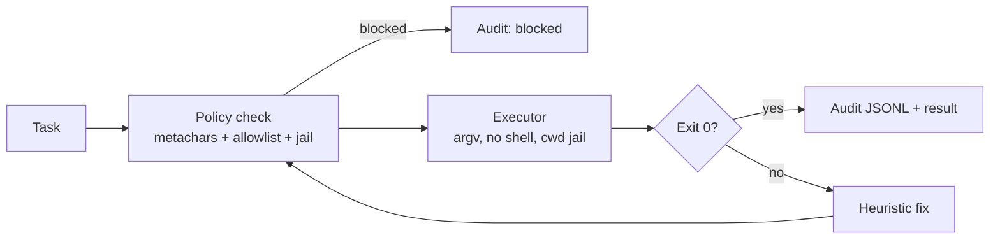

# Terminal Agent

[](https://github.com/lionelsimai/terminal-agent/actions/workflows/ci.yml)
[](LICENSE)
[](https://www.python.org/)

**Autonomous shell execution with self-debug loops.**

**Target:** Top 10 on Terminal-Bench.
**Shows:** Agents that operate real systems safely.

## Problem -> Solution
LLM agents that run shell commands fail on typos, missing files and wrong
interpreters — and unsafe agents can destroy a machine. Terminal Agent
tackles both with a **policy-gated executor** (argv-only execution with no
shell, allowlist + blocklist, shell-metacharacter rejection, cwd jail,
scrubbed environment, timeout, and an audit log that records blocked
attempts too) plus a deterministic self-debug loop that fixes common
failures and retries.

## Security model
- **No shell, ever.** Commands are `shlex`-parsed and executed as argv.
  Metacharacters used as shell syntax (`; & | $ \` > <`, newline,
  `$(...)`) are rejected before execution — `echo hi; cat /etc/passwd`
  is blocked and audited, not executed.
- **Jail via `Path.is_relative_to`.** Path arguments must resolve inside
  the jail; `../jail-evil` sibling-prefix escapes fail.
- **Scrubbed environment.** Children get PATH / HOME(=jail) / LANG only —
  parent secrets in `os.environ` are not inherited.
- **Code execution is opt-in.** Bare `python` is not allowlisted.
  `python3` is allowlisted for interpreter checks, but `python3 -c ...`
  and `python3 script.py` require `--allow-code-exec` (CLI) /
  `allow_code_exec=True`.
- **Audit covers attacks.** Blocked attempts are written to the JSONL
  audit log before the error propagates.

## Architecture


## Quickstart (<2 min)
```bash
git clone https://github.com/lionelsimai/terminal-agent.git
cd terminal-agent
pip install -e .
terminal-agent demo
terminal-agent run "echo hello"
```

## Real demo output
```
[PASS] 'echo hello from terminal-agent' -> 'echo hello from terminal-agent' attempts=1 output='hello from terminal-agent'
[PASS] 'python --version' -> 'python3 --version' attempts=2 output='Python 3.12.3'
[PASS] 'ehco self-debug works' -> 'echo self-debug works' attempts=2 output='self-debug works'
[PASS] 'cat notes.txt' -> 'cat notes.txt' attempts=3 output=''
demo: 4/4 tasks succeeded
```
(Exact Python version varies by machine; run `terminal-agent demo` to see yours.)

## Benchmarks
```bash
python benchmarks/bench.py
```
Measures self-debug success on 12 fixture tasks using the **shipped**
configuration (default allowlist, policy gate on). The set mixes healthy
tasks, fixer-covered failures, and held-out failures the fixer does not
cover (missing-file reads via `grep`/`wc`/`sort`, a `$(...)`
substitution, an absolute path outside the jail).
Local reference run (2026-11-09, this machine): without debug 3/12 = 25%,
with self-debug 7/12 = 58%.
Headline target: Top 10 on Terminal-Bench — the local fixture rate is a
proxy, not a Terminal-Bench submission score. (0.1.0 reported 100% on 8
fixtures; that set contained only fixer-covered failures and ran with
the allowlist disabled, so the number was not comparable.)

## Limitations (honest)
- **This is policy-gating, not a sandbox.** There is no container/VM/OS
  isolation boundary. An allowlisted program can still do anything that
  program can do inside the jail — remove programs from the allowlist
  (e.g. pass a custom list without `python3`) when that is too much.
- Even with `-c`/script gating, `python3` on the allowlist is a risk
  decision, not a guarantee. Residual risk accepted for the demo
  workflow; production use should run inside a container.
- Heuristic fixes cover common cases only; novel failures need an LLM
  fixer. Fixes that fabricate state (e.g. `touch` before `cat`) make the
  command succeed, which is not always the same as the task succeeding.
- Metacharacter rejection is quote-aware and conservative; exotic
  quoting may be refused even when harmless.

## Roadmap
- [ ] Container-backed executor, Terminal-Bench harness adapter
- [ ] LLM-backed fixer behind an interface (offline heuristics stay default)
- [ ] Risk scoring per command, human approval for high-risk classes

## Contributing
See [CONTRIBUTING.md](CONTRIBUTING.md). Licence: MIT — see [LICENSE](LICENSE).
