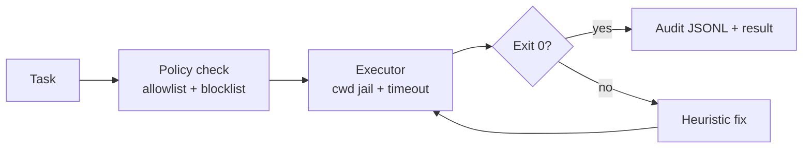

# Terminal Agent

[](https://github.com/lionelsimai/terminal-agent/actions/workflows/ci.yml)
[](LICENSE)
[](https://www.python.org/)

**Autonomous shell execution with self-debug loops.**

**Target:** Top 10 on Terminal-Bench.
**Shows:** Agents that operate real systems safely.

## Problem -> Solution
LLM agents that run shell commands fail on typos, missing files and wrong
interpreters — and unsafe agents can destroy a machine. Terminal Agent solves
both: a sandboxed executor (allowlist, blocklist, cwd jail, timeout, audit log)
plus a deterministic self-debug loop that fixes common failures and retries.

## Architecture


## Quickstart (<2 min)
```bash
git clone https://github.com/lionelsimai/terminal-agent.git
cd terminal-agent
pip install -e .
terminal-agent demo
terminal-agent run "echo hello"
```

## Real demo output
```
[PASS] 'echo hello from terminal-agent' -> 'echo hello from terminal-agent' attempts=1 output='hello from terminal-agent'
[PASS] 'python --version' -> 'python3 --version' attempts=2 output='Python 3.12.3'
[PASS] 'ehco self-debug works' -> 'echo self-debug works' attempts=2 output='self-debug works'
[PASS] 'cat notes.txt' -> 'touch notes.txt && cat notes.txt' attempts=2 output=''
demo: 4/4 tasks succeeded
```
(Exact Python version varies by machine; run `terminal-agent demo` to see yours.)

## Benchmarks
```bash
python benchmarks/bench.py
```
Measures self-debug success rate on 8 fixture tasks (broken and healthy).
Local reference run (2026-11-09, this machine): without debug 2/8 = 25%, with self-debug 8/8 = 100%.
Headline target: Top 10 on Terminal-Bench — the local fixture rate is a proxy,
not a Terminal-Bench submission score.

## Limitations (honest)
- Heuristic fixes cover common cases only; novel failures need an LLM fixer.
- Shell sandboxing is policy + jail, not a container/VM boundary.
- Allowlist defaults are conservative; real work may need a wider list.

## Roadmap
- [ ] Container-backed executor, Terminal-Bench harness adapter
- [ ] LLM-backed fixer behind an interface (offline heuristics stay default)
- [ ] Risk scoring per command, human approval for high-risk classes

## Contributing
See [CONTRIBUTING.md](CONTRIBUTING.md). Licence: MIT — see [LICENSE](LICENSE).
